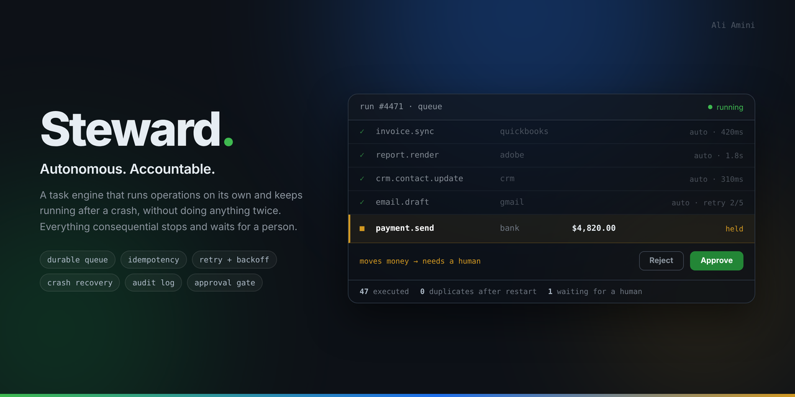

# Steward



An autonomous operations engine with a human approval gate. It runs unattended,
survives restarts, and is built so that a consequential action, such as sending
an email or creating an invoice, is never performed twice.

This is the reliability core that a business automation ("AI COO") system needs
before any of its integrations can be trusted. The integrations are the easy,
replaceable part. The hard part is making an always-on worker that does the
right thing after a crash, and that is what this project is about.

## The problem it solves

An automation that acts on your behalf has two failure modes that matter:

1. It does something twice. The process dies after sending an email but before
   recording that it sent it, restarts, and sends it again.
2. It does something it should not have. It emails a customer or moves money
   without anyone approving it.

Steward is designed around both. Every unit of work goes through a durable
queue with an idempotency guarantee, and any action marked consequential waits
for explicit human approval before it runs.

## Status

Built and tested:

- Durable job queue on SQLite that survives process restarts.
- Idempotent enqueue: the same idempotency key never creates a second job.
- Retry with exponential backoff, and a terminal `failed` state after
  `max_attempts`.
- Lease-based crash recovery: a job whose worker died is returned to the queue
  once its lease expires, and reruns without repeating its side effect.
- An append-only audit log of every state change.
- A mock connector (email) that is idempotent at the data layer, mirroring how
  real providers (Stripe, SendGrid) use an idempotency key.

Planned, built in stages:

- A human approval gate for consequential actions.
- An approval dashboard (pending / approved / rejected / failed / completed).
- More mock connectors (CRM, invoicing).
- The AI layer described below.

## The AI layer

An automation like this is more useful when a step can draft something, for
example a reply to a customer email, and leave the decision to a human. The
model never acts on its own; it proposes, the approval gate holds the proposal,
and a person approves or rejects it.

The intelligence is added in four stages, from the simplest and most honest to
the most involved. Each one is a real, well-understood technique, not a claim
to have built a model from scratch. Training a base language model is the work
of a large research team and is out of scope here; Steward uses a model, it
does not try to be one.

1. **Use a model.** A drafting step calls a model API (OpenAI, Anthropic, or a
   local model) behind a thin adapter. The default adapter is a mock that
   returns a fixed draft, so the system runs and is testable with no API key.
   The model is used, not changed.

2. **Give it memory (retrieval).** Before drafting, the step retrieves relevant
   past context, approved replies, account history, documents, and passes it to
   the model. The model stays fixed; the system behaves as if it has learned
   because its answers are grounded in your own data.

3. **Learn from approvals (feedback loop).** Every approval and rejection is
   already recorded by the approval gate. That log becomes training signal:
   the drafting step is shown previously approved examples so new drafts move
   toward what a human has accepted before. This is learning at the level of
   examples and memory, built on data the system already keeps.

4. **Fine-tune (optional).** When there is enough approved history, a base
   model can be lightly fine-tuned on it to match a house tone or format.
   This actually adjusts the model, but only its style, and in practice stages
   2 and 3 cover most needs more cheaply.

The through-line: Steward never pretends to think on its own. It acts
autonomously, keeps a record of every human decision, and uses that record to
get better. Stages 1 and 2 are the near-term targets; 3 and 4 build on the
approval history the gate produces.

## The guarantee, and the test that proves it

The important claim is "a crash mid-job does not cause a duplicate side
effect". The test in `test/queue.test.js` sets it up directly: a handler sends
an email and then throws before the job is marked complete, exactly like a
process dying mid-flight. The lease expires, a fresh worker recovers the job
and reruns it, and the test asserts the email was sent exactly once.

It works because of two things together:

- A leased job whose worker vanished is reclaimed, so nothing is silently lost.
- The side effect itself is keyed, so running it a second time is a no-op.

## Run it

```bash
npm install
npm test        # 4 passing
npm run demo    # a small end-to-end run you can watch
```

## Layout

```
src/
  db.js               schema: jobs, audit_log, connector output
  queue.js            enqueue, claim, complete, fail, retry, recovery
  worker.js           the processing loop and crash recovery
  audit.js            append-only audit log
  connectors/
    email.js          idempotent mock connector
test/
  queue.test.js       idempotent enqueue, retry, and the crash test
scripts/
  demo.js             end-to-end example
```

## Related work

The same reliability discipline, applied to a different domain, is in
[LiveReel](https://github.com/charlie-hk/livereel-media-pipeline), a control
plane for live media pipelines with supervised processes and restart recovery.

## License

MIT.
