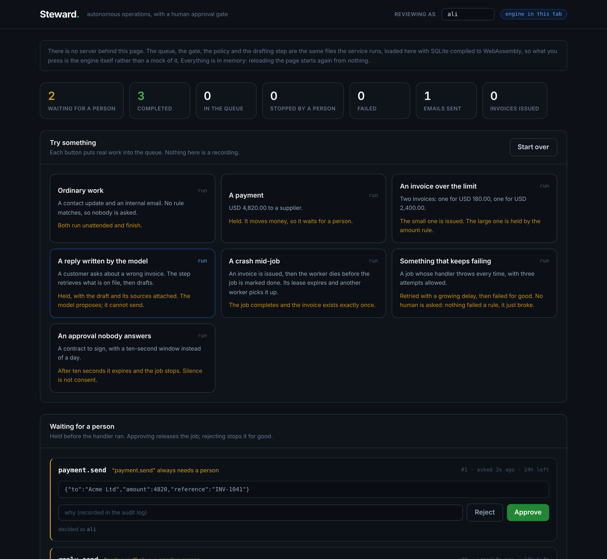

# Steward


An autonomous operations engine with a human approval gate. It runs unattended,
survives restarts, and is built so that a consequential action, such as sending
an email or issuing an invoice, is never performed twice and never happens
without a person agreeing to it.

This is the reliability core that a business automation ("AI COO") system needs
before any of its integrations can be trusted. The integrations are the easy,
replaceable part. The hard part is an always-on worker that does the right
thing after a crash, and that knows which of its own actions it is not allowed
to take alone.

     

**[Open the panel](https://charlie-hk.github.io/steward/)** - the real engine,
running in your browser. Press a scenario and decide what it holds.

```bash
npm install
npm test            # 35 passing
npm run demo:ai     # retrieve, draft, hold, decide, learn
npm start           # the worker and the panel on http://localhost:3000
```

## The problem it solves

An automation that acts on your behalf has two failure modes that matter:

1. It does something twice. The process dies after sending an email but before
   recording that it sent it, restarts, and sends it again.
2. It does something it should not have. It emails a customer or moves money
   without anyone approving it.

Steward is designed around both. Every unit of work goes through a durable
queue with an idempotency guarantee, and any action a rule marks consequential
waits for an explicit human decision before it runs.

## The approval gate

The worker asks the gate about every job it claims, **before** the handler
runs, so nothing has happened yet when a person is asked about it.

```
                   +-- no rule matched ------------------> run the handler
claim a job -----> |
                   +-- a rule matched --> awaiting_approval
                                                |
                                   approve ---> back in the queue, runs once
                                   reject  ---> rejected, the handler never runs
                                   nobody  ---> expired, the handler never runs
```

The rules are plain functions, so a deployment supplies its own without
touching the engine (`src/policy.js`). The defaults hold anything that moves
money or signs something, any payload over a limit, any email leaving the
organisation, and anything a model wrote:

```js
const { makePolicy, alwaysHold, amountOver } = require('./src/policy');

const policy = makePolicy([
  alwaysHold(['payment.send', 'contract.sign', 'reply.send']),
  amountOver(500),
]);
```

Four details matter more than the feature itself, and each has a test:

- **One request per job.** `approvals.job_id` is UNIQUE. A job that is claimed,
  held, and claimed again does not open a second request, so a restart loop
  cannot turn into a flood of notifications.
- **One decision, ever.** The decision is an UPDATE conditional on the row
  still being pending, inside the same transaction that releases the job. Two
  reviewers pressing Approve at the same moment produce one decision and one
  run; pressing it twice changes nothing, and over HTTP the second press gets
  a 409 that says who decided and what they decided.
- **The decision outranks the rule.** The policy is consulted once, the first
  time a job reaches the gate, and the answer is written down. Changing the
  rules afterwards does not re-open a job a person has already approved.
- **Silence is not consent.** An approval nobody answers expires and the job
  stops. Waiting also consumes no retry attempt: a job held for review has not
  failed, and must not burn its budget while it waits.

A gate nobody is told about is a queue that stopped, so the gate takes a
notifier (`src/notify.js`) and calls it exactly once per request. Console and
an idempotent mock email are included; a notifier that throws is logged and
never fails the job.

## The panel

[](https://charlie-hk.github.io/steward/)

`npm start` runs the worker and serves the panel on port 3000. It shows what is
waiting and why, the draft text when a model wrote one, the policy, every job's
state and the audit log. Approve and Reject take a note, and the note goes into
the log with the name of whoever decided.

The same build is published at
**[charlie-hk.github.io/steward](https://charlie-hk.github.io/steward/)**, and
that page has no server behind it. It is not a mock either: the panel imports
the real queue, gate, policy and drafting step from `src/`, and swaps only the
database for SQLite compiled to WebAssembly. A rule change changes the demo
with it. The scenarios on the page are the same ones the API exposes, defined
once in `src/scenarios.js`:

| | what it shows |
|---|---|
| Ordinary work | no rule matches, so nobody is asked |
| A payment | held, because it moves money |
| An invoice over the limit | one issued, one held, same job type |
| A reply written by the model | retrieval, a draft, and a model that cannot send |
| A crash mid-job | the lease expires, another worker finishes it, one invoice exists |
| Something that keeps failing | retry with backoff, then a terminal failure, no human asked |
| An approval nobody answers | it expires and the job stops |

The API underneath is deliberately thin, because every rule lives in the gate:

```
GET  /api/summary                  counts
GET  /api/approvals                what is waiting, with its draft
GET  /api/jobs   GET /api/audit
GET  /api/scenarios                POST /api/scenarios/:key to run one
POST /api/approvals/:id/approve    { by, note }   409 if already decided
POST /api/approvals/:id/reject     { by, note }
```

There is also a CLI, for a server with no browser on it:

```bash
node scripts/review.js list
node scripts/review.js approve 2 --by ali --note "invoice checked"
node scripts/review.js audit
```

## Running unattended

`npm start` is a long-running service, not a script that drains the queue and
exits. It polls, recovers crashed jobs, and expires unanswered approvals on
every cycle.

Shutdown is the part worth reading (`src/runner.js`). On SIGINT or SIGTERM it
stops accepting new work, waits for the job in flight to finish, then closes
the database. A worker killed mid-job is exactly the crash this project is
about, so the service refuses to become one. A second signal exits immediately,
for when the operator has run out of patience.

## Connectors

Mocks, and the mock is the point: each one is idempotent at the data layer,
the same way Stripe and SendGrid are through an idempotency key.

| | what it proves |
|---|---|
| `connectors/email.js` | the same key sends once; operator alerts are counted apart from customer mail |
| `connectors/crm.js` | a contact is upserted, so a rerun updates one row instead of creating a second person |
| `connectors/invoicing.js` | the same invoice is issued once, at the amount it was first issued at, and a nonsense amount is refused rather than stored |

## The AI layer

A model is more useful here than anywhere else in the system, because the
approval gate already exists: the model proposes, a person decides, and only
then does anything happen. Four stages, from the most honest to the most
involved.

**1. Use a model** (`src/ai/model.js`). One method, `complete({ system, prompt })`.
The default adapter is a mock that needs no API key, so the system runs and is
testable offline and the tests do not depend on a third party's wording. A real
provider is a constructor argument; set `STEWARD_MODEL_URL` and
`STEWARD_MODEL_KEY` and nothing else changes. The drafting handler writes a
draft and enqueues the job that would send it, and that job is what the gate
holds, so the model never has a path to the outside world.

**2. Retrieval** (`src/ai/retrieve.js`). Before drafting, the step pulls the
most relevant documents and passes them in, and the draft records which ones it
used. This is keyword scoring, weighted so a rare shared word counts for more
than a common one. Stating the limit plainly: it finds documents sharing words
with the question and will miss one that means the same thing in different
words. It needs no vector database, no embedding API and no network, and the
interface is the part that matters, since an embedding search would replace one
function and nothing above it.

**3. Learn from approvals** (`src/ai/examples.js`). No new storage and no
training run. The approval log already records what a person was willing to
send, so the next draft on the same topic is shown the drafts that were
approved, and a short list of what a reviewer turned down and why. Rejected
drafts are never shown as examples to imitate.

**4. Fine-tune** (`src/ai/training.js`, `scripts/export-training.js`). Exports
the approved history as the JSONL file a provider's fine-tuning endpoint takes,
and refuses to write a set too small to be worth anything. **No model here has
been fine-tuned.** The export is built and tested; running it is a provider
operation that costs money and needs a real approval history. On the evidence
of stages 2 and 3, most of the benefit arrives before you would need it.

The through-line: Steward never pretends to think on its own. It acts
autonomously, keeps a record of every human decision, and uses that record to
get better.

## The guarantee, and the test that proves it

The important claim is "a crash mid-job does not cause a duplicate side
effect". The test in `test/queue.test.js` sets it up directly: a handler sends
an email and then throws before the job is marked complete, exactly like a
process dying mid-flight. The lease expires, a fresh worker recovers the job
and reruns it, and the test asserts the email was sent exactly once.

It works because of two things together:

- A leased job whose worker vanished is reclaimed, so nothing is silently lost.
- The side effect itself is keyed, so running it a second time is a no-op.

The figures on the cover image are not an illustration either. They come from
`node scripts/figures.js`, a run that enqueues real work, crashes mid-invoice,
restarts, and prints what it ended up with.

## Run it

```bash
npm install
npm test                  # 35 passing
npm --prefix web install
npm run test:web          # 9 more, including the engine on WebAssembly SQLite
npm run build:web         # type check and build the panel into docs/
npm run demo              # the durable queue, end to end
npm run demo:gate         # the approval gate, end to end
npm run demo:ai           # retrieval, drafting, approval, learning
npm start                 # worker + panel, http://localhost:3000
npm start -- --db data/ai-demo.db    # or point it at a demo database
```

## Layout

```
src/
  db.js               schema and migrations
  queue.js            enqueue, claim, complete, fail, retry, hold, release
  worker.js           the processing loop, crash recovery, the gate check
  runner.js           the long-running service and its graceful shutdown
  gate.js             approval requests, decisions, expiry
  policy.js           the rules that decide what needs a person
  notify.js           telling someone that something is waiting
  audit.js            append-only audit log
  server.js           the dashboard API
  steward.js          one place that wires the parts together
  cli.js              the service entry point
  ai/
    model.js          the model adapter, mock by default
    retrieve.js       keyword retrieval over the document store
    examples.js       approved drafts as examples, rejections as warnings
    draft.js          the drafting and sending handlers
    training.js       the fine-tuning export
  scenarios.js        the demo situations, shared by the API and the panel
  connectors/         email, crm, invoicing - all idempotent mocks
web/                  the React panel, and the engine running in a browser
docs/                 the built panel, served by GitHub Pages and by the service
test/                 queue, approvals, connectors, notify, runner, ai, server
scripts/              demo, demo-gate, demo-ai, review, export-training, figures
```

## What is verified, and what is not

Written out plainly, because "has an AI layer" and "has been fine-tuned" are
not the same claim.

| Area | Status | How |
|---|---|---|
| Durable queue, idempotency, retry, crash recovery | **verified** | 4 tests, including the crash-mid-job duplicate test |
| Approval gate: held, approved, rejected, expired, decided twice, survives restart | **verified** | 8 tests |
| Connectors: email, CRM, invoicing | **verified** | 3 tests, idempotency on each |
| Notifier: fires once, survives a failing channel | **verified** | 3 tests |
| Long-running service and graceful shutdown | **verified** | 3 tests, including that stopping waits for the job in flight |
| Dashboard API, including 409 on a second decision | **verified** | 7 tests against a real listening server over HTTP |
| The engine running on WebAssembly SQLite in a browser | **verified** | 5 tests in `web/`: the adapter, a rollback, hold and approve, a crash mid-job, and idempotency |
| The panel itself | **verified** | 4 component tests, plus a headless browser run of the published build: scenarios, a decision, and the counts moving |
| Retrieval, drafting, learning from approvals, training export | **verified with the mock model** | 6 tests |
| A real model provider | **implemented, not run** | No API key in the test environment. The adapter is 20 lines against the standard chat completion shape. |
| Fine-tuning | **export only** | The JSONL is built and tested. No fine-tune has been run. |
| Running against a real email, CRM or payment provider | **not done, by design** | Every connector is a mock. This repository is about the engine, not the integrations. |

## Related work

The same reliability discipline, applied to a different domain, is in
[LiveReel](https://github.com/charlie-hk/livereel-media-pipeline), a control
plane for live media pipelines with supervised processes and restart recovery.

## License

MIT.
